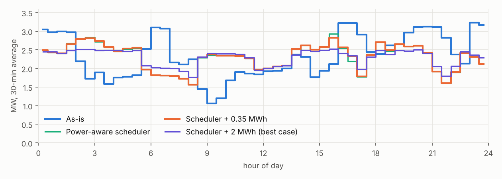

# GridTwin

Unlock the power your AI data center already paid for.

## What we built

- **A digital twin** of an AI-training data center's power chain, from the 13.8 kV grid feed down to the GPUs, simulated every second for 24 hours with measured H100 power traces.
- **A predictor** that forecasts the site's grid draw from 1 second to 4 hours ahead.
- **A controller** that flattens that draw: a power-aware job scheduler plus the site's existing battery.

AI training makes a site's power swing every ~10 s as GPUs alternate between computing and syncing, and jump by megawatts when large jobs start or stop. Transformers, switchgear, grid contracts and demand charges are all sized and billed on those peaks. GridTwin shows how much of the peak can be removed, and what that's worth.

## Who it's for

- **Operators of small and mid-size AI data centers** (colocation sites, GPU clouds, AI training clusters, roughly 1–50 MW) who are paying for grid capacity sized for spikes they rarely hit.
- Their **CFO or head of facilities**, who sees the result two ways: lower demand charges, and room for more GPUs on the power the site already has, without waiting years for a grid upgrade.

## How it works, in short

1. **Simulate:** the twin replays real GPU power traces for every job on the cluster and pushes the total through every device on the site's one-line (converters, buses, transformer, feeds) and the cooling plant. Its output is what the utility meter would see.
2. **Predict:** the scheduler already knows what's running, what's queued and how long jobs asked for. GridTwin turns that into a forecast of power at the meter, and adds a short-term model for the ~10 s training swing.
3. **Flatten:** using the forecast, the scheduler stops jobs from stacking past a power cap, and the battery smooths what's left and shaves the peak.

Details are under [How it works](#how-it-works) below.



## Results (simulation, 24 h at 1 s)

Twin: 4.2 MW site, 1,084 GPU nodes (4× H100 each), driven by measured H100 training power traces.

| | As-is | Scheduler + 0.35 MWh battery |
|---|---|---|
| Billed 30-min peak | 3.23 MW | **2.83 MW (−12.5%)** |
| 1 s jumps > 0.2 MW per day | ~8,000 | **0** |
| Training-step swing at the meter (std) | 0.17 MW | **0.01 MW** |
| LV bus peak loading | 86% | **66%** |
| Net savings (Dominion GS-4-style demand tariff) | | **≈ $89k / yr** |

Forecasting: about 2× more accurate than persistence 1–5 s ahead, and 25–30% more accurate 1–4 h ahead. No better than persistence at 5–15 min, where the load moves only when a large job starts or ends.

The cost: capping the cluster at 85% of nodes raises mean queue wait from 24 to 104 min. A 90% cap keeps about 70% of the savings with 74 min of mean wait.

**Projected linearly to a 1 GW campus:** 125 MW of peak grid power freed on the same connection, about the electricity of 100,000 US homes and one typical AI data center (IEA). That's $21–30M a year in demand charges, and about $1.4B of build at $11.3M/MW. This projection assumes the same load shape at scale. Larger sites smooth naturally, so the real percentage may be smaller.

The full write-up with all charts is in [`results/report.html`](results/report.html).

## How it works

```
NLR H100 traces ──► IT layer ──► electrical chain ──► cooling plant ──► site draw (CSV, 51 channels, 1 s)
 (measured)        jobs, FIFO     DC bus, 36 AFEs,     CDU, dry cooler,
                   scheduler      480 V, transformer,  chiller, pumps
                                  13.8 kV feeds
                       ▲                                                     │
                       └──────── scenarios (scheduler, battery) ◄── predictor ◄┘
```

**Twin (`matlab/`).** Builds a 1,084-node hall from the 4.2 MW power budget, generates a day of training jobs (16–512 nodes, 30 min–6 h, afternoon-heavy arrivals), and replays a measured per-node trace for each job. Hall load is then pushed through every device on the one-line (losses, DC bus droop, percent of rating) and a liquid/air cooling plant. Faults can be injected: HX fouling, AFE trips, fan failure, feed loss, utility loss, pump degradation.

**Predictor (`analysis/analyze.py`, stage A).** Three layers:
1. **Scheduler layer (minutes to hours):** running jobs, requested walltimes and the queue, replayed forward with the FIFO rule, blending toward an hour-of-day prior for jobs that haven't arrived yet. Busy nodes × learned kW per node gives IT load.
2. **Oscillation layer (1–60 s):** an AR(40) model on the residual, refit every 5 min.
3. **Facility layer:** a regression from forecast IT load, forecast ambient and current cooling state to site draw.

It is trained on six other twin days (seeds 11–16) and tested on the headline day (seed 7), so nothing from the test day leaks in.

**Flattening (`analysis/analyze.py`, stage B).** Each scenario rebuilds the hall IT load from the job table and measured traces (`analysis/twin_it.py`, an exact mirror of `dctwin_itload_traces.m`), then re-runs the twin for electrical and cooling:
- **Power-aware scheduler:** a job starts only if busy nodes stay at or below a cap. Optional extras: soft 120 s ramp-in and 60 s wind-down, and phase interleaving.
- **Battery:** smooths toward a 2-minute mean of the predicted draw, and peak-shaves to a cap while charge stays above 35%. If a cap proves too low it ratchets up, because a monthly demand peak, once set, is sunk.

## Repository layout

```
matlab/      the digital twin (MATLAB; also runs in GNU Octave)
octave/      Octave runners + a CSV trace loader (Octave has no parquetread)
analysis/    predictor, scenarios, figures, HTML report (Python)
scripts/     trace conversion and the end-to-end pipeline
prototype/   first synthetic-data prototype of the predictor (superseded by analysis/)
results/     figures and report from the last full run
data/        generated, git-ignored (traces CSV, twin runs)
```

## Running it

**Data.** Download the NLR *Dataset of Generative AI Workload Power Profiles* ([doi:10.7799/3025227](https://doi.org/10.7799/3025227)). You need its `01_aggregated_datasets` folder; only `training/` is used.

**Everything, with Octave (about 15 min):**

```bash
pip install -r requirements.txt
bash scripts/run_all.sh /path/to/dataset/01_aggregated_datasets
open results/report.html
```

**Just the twin, in MATLAB:**

```matlab
addpath('matlab')
p = dctwin_config();
p.it.data_root = '/path/to/dataset/01_aggregated_datasets';
p.T_end = 600;            % 10-minute smoke test; remove for the full 24 h
D = dctwin_run(p);        % writes dctwin_data.csv and prints a loading summary
dctwin_plot_it(D);
```

Octave gives a different random stream from MATLAB for the same seed, so the job mix differs between them. The physics is identical. Published results come from Octave.

## Assumptions and limits

- One workload (Llama-2 70B LoRA fine-tuning). Jobs above 16 nodes are built from 16-node traces. Nodes in a job run in lockstep (`sync_jitter_s = 0`).
- The job mix, the cooling plant and the converter and transformer loss curves are modelled, not measured. Only per-node GPU/CPU power is measured. Breakers are checked against ratings but have no trip logic.
- 0.2 s trace sampling can't see swings above 2.5 Hz. Job endings are instantaneous, so job-boundary jumps are upper bounds.
- The twin has no requested walltimes, so users are assumed to request 1.0–1.6× the true runtime. Battery smoothing assumes job-end telemetry accurate to about 20 s. The battery is applied at the meter, not inside the DC bus model.
- Tariff: $19.40/kW-month on the monthly 30-min peak (Dominion GS-4 primary on-peak generation, transmission and distribution demand plus riders, 2025 filings), with energy at $70/MWh. One day stands in for the month's worst day.

## Sources

- Vercellino et al., *Dataset of Generative AI Workload Power Profiles*, NLR, [doi:10.7799/3025227](https://doi.org/10.7799/3025227); paper arXiv:2604.07345 (2026)
- IEA, [*Energy and AI*](https://www.iea.org/reports/energy-and-ai/executive-summary) (2025): a typical AI-focused data center uses as much electricity as 100,000 households
- EIA, [average US household electricity use](https://www.eia.gov/tools/faqs/faq.php?id=97&t=3): 10,791 kWh/yr
- JLL 2026 forecast via [Datacentres.com](https://www.datacentres.com/news/data-centre-construction-costs-11m-per-mw): $11.3M per MW build cost
- Dominion Energy Virginia, [Schedule GS-4](https://www2.dominionenergy.com/-/media/pdfs/virginia/business-rates/schedule-gs4.pdf) and riders
